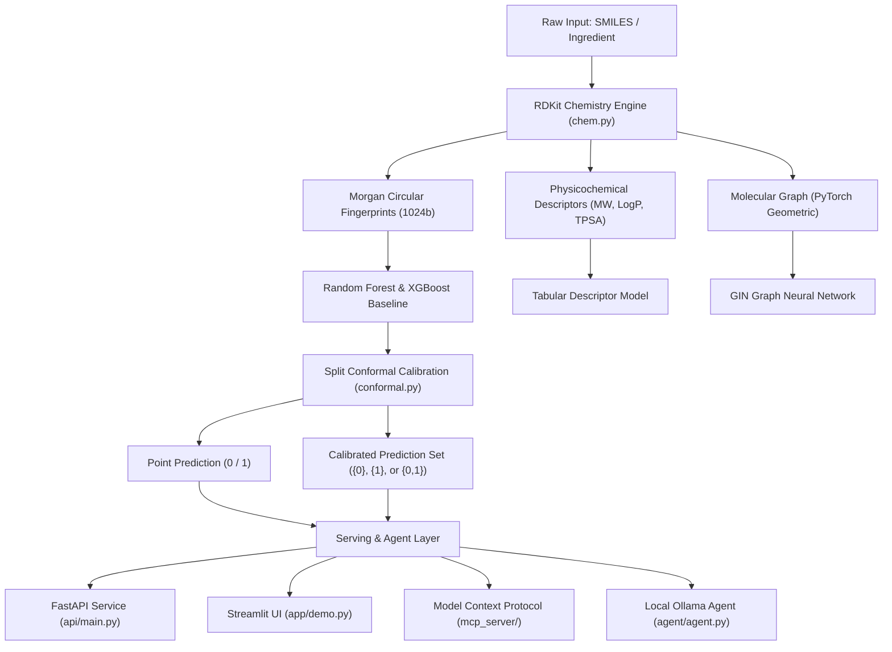
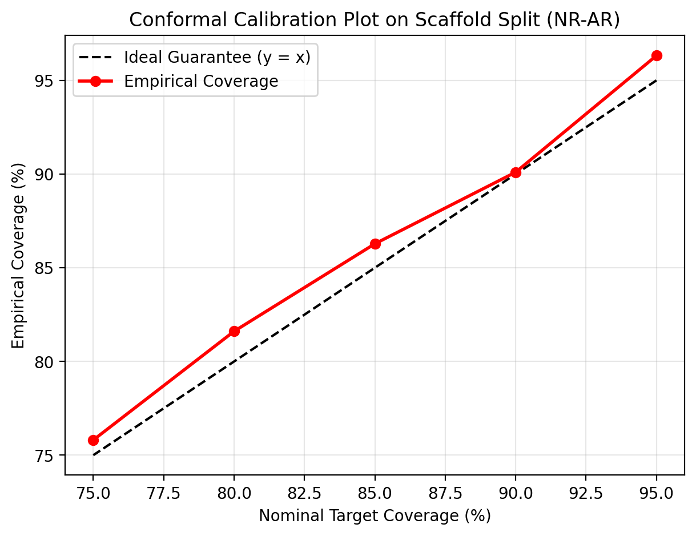

# 🔬 ToxiLens: Offline Molecule Safety Screener

[](https://github.com/23f3003672/ToxiLens/actions)
[](https://opensource.org/licenses/MIT)
[](https://www.python.org/downloads/)

> **An offline, private molecular safety screener that predicts toxicity using machine learning and says "I don't know" when it is not sure.**

Built for small cosmetic, fragrance, and household cleaning-product formulators who cannot afford an in-house toxicologist or expensive enterprise software suites. Everything runs locally on consumer hardware (tested on an Intel Core i3 with 8 GB RAM), ensuring proprietary formulas never leave the machine.

---

## 🏛 Architecture Diagram



---

## 📊 Benchmark Results

### 1. Honest Evaluation: Random Split vs. Scaffold Split (NR-AR Assay)
In computational chemistry, molecules often belong to structural congener series (analogs with the same core ring). A standard random split scatters analog twins across train and test sets, causing **data leakage** and artificially flattering the model. We implemented our own Bemis-Murcko scaffold split by hand:

| Split Method | Scaffold Leakage into Test | Test AUROC | Observed Drop |
| :--- | :---: | :---: | :---: |
| **Random Split** | 49.8% | **0.8142** | Baseline |
| **Bemis-Murcko Scaffold Split** | **0.00%** | **0.7233** | **-11.2%** |

*Takeaway:* The 11.2% score drop demonstrates the true difficulty of out-of-distribution generalization to completely novel chemical families.

---

### 2. Full 12-Assay Tox21 Benchmark on Scaffold Split

Evaluated using our unified, model-agnostic harness (`src/toxilens/evaluate.py`):

| Assay Target | Description | Labeled Test Samples | RF AUROC | RF PR-AUC | XGB AUROC | XGB PR-AUC |
| :--- | :--- | :---: | :---: | :---: | :---: | :---: |
| **NR-AR** | Androgen Receptor | 707 | 0.7496 | 0.4530 | 0.7435 | 0.3526 |
| **NR-AR-LBD** | Androgen Receptor (Ligand Binding) | 618 | 0.7978 | 0.3708 | 0.7323 | 0.2417 |
| **NR-AhR** | Aryl Hydrocarbon Receptor | 605 | 0.7822 | 0.5203 | 0.7711 | 0.4167 |
| **NR-Aromatase** | Aromatase Enzyme Inhibition | 497 | 0.6513 | 0.3089 | 0.5948 | 0.2675 |
| **NR-ER** | Estrogen Receptor Alpha | 548 | 0.6430 | 0.3452 | 0.6510 | 0.3325 |
| **NR-ER-LBD** | Estrogen Receptor (Ligand Binding) | 659 | 0.8133 | 0.4184 | 0.7167 | 0.3431 |
| **NR-PPAR-gamma** | Peroxisome Proliferator Receptor | 567 | 0.7697 | 0.2842 | 0.6952 | 0.3222 |
| **SR-ARE** | Antioxidant Response Element | 466 | 0.7146 | 0.4676 | 0.6062 | 0.3592 |
| **SR-ATAD5** | Genotoxicity / DNA Damage | 653 | 0.7086 | 0.2065 | 0.6144 | 0.1347 |
| **SR-HSE** | Heat Shock Response | 563 | 0.7113 | 0.2529 | 0.6687 | 0.1396 |
| **SR-MMP** | Mitochondrial Membrane Potential | 505 | 0.7680 | 0.5438 | 0.7204 | 0.4309 |
| **SR-p53** | p53 Tumor Suppressor Pathway | 630 | 0.7106 | 0.3018 | 0.6535 | 0.2180 |
| **MACRO AVERAGE** | **Across All 12 Assays** | **7,018** | **0.7350** | **0.3728** | **0.6806** | **0.2966** |

---

### 3. Representation Ablation: Fingerprints vs. Descriptors vs. Graphs

Evaluated on the `NR-AR` endpoint:

| Model Architecture | Molecular Representation | AUROC | PR-AUC | Key Insight |
| :--- | :--- | :---: | :---: | :--- |
| **Random Forest** | Morgan Fingerprints (1024b, r=2) | **0.7496** | **0.4530** | Best overall: Explicit circular sub-structures directly capture local toxicophores. |
| **Tabular NN** | 10 Physicochemical Descriptors | **0.7098** | **0.3016** | Captures bulk properties (lipophilicity/size) but lacks positional isomer sensitivity. |
| **GIN (GNN)** | Molecular Graph (Atoms & Bonds) | **0.6455** | **0.2400** | Overfits on small scaffold splits without pretraining; messages smooth over rare toxic motifs. |

---

## 🎯 Calibrated Uncertainty with Conformal Prediction

Unlike standard softmax probabilities which are notoriously overconfident and uncalibrated, ToxiLens implements **Split Conformal Prediction** from scratch using NumPy.

For any nominal coverage guarantee $1 - \alpha$ (e.g. 90%), the model outputs a prediction set $\Gamma(X) \subseteq \{0, 1\}$:
- **`{0}`**: Confidently Non-Toxic (at 90% confidence).
- **`{1}`**: Confidently Toxic (at 90% confidence).
- **`{0, 1}`**: **"I don't know / Uncertain"** — both outcomes remain plausible under the evidence threshold.
- **`{}`**: Outlier / out-of-distribution molecule.

### Conformal Calibration Plot
The calibration curve demonstrates that empirical test coverage tracks nominal mathematical coverage:



---

## 🔍 Interpretability & Allergen Screening

1. **Substructure Attribution:** Maps active Morgan fingerprint bits back to the originating atom indices and highlights them on 2D RDKit drawings.
2. **Structural Alerts (Toxicophores):** Automatically identifies classical reactive chemical motifs via SMARTS (Nitroaromatics, Michael Acceptors, Epoxides, Aromatic Amines).
3. **Cosmetic Allergen Registry:** Flags candidate molecules against the official EU cosmetics and fragrance allergen annex (`data/allergens.csv`).

---

## 🚀 Quickstart: Run in Under 10 Minutes

### Prerequisites
- Python 3.10, 3.11, or 3.12
- Git

### 1. Clone & Set Up Virtual Environment
```bash
git clone https://github.com/23f3003672/ToxiLens.git
cd ToxiLens

python -m venv .venv
source .venv/Scripts/activate  # On Linux/macOS: source .venv/bin/activate
pip install --upgrade pip
pip install -r requirements.txt
```

### 2. Run Pre-Trained Benchmark Suite
Models are pre-trained and saved in `models/toxilens_bundle.joblib`. To re-run the full training, calibration, and ablation benchmark:
```bash
python scripts/train_all.py
```

### 3. Launch Interactive Streamlit UI
```bash
streamlit run app/demo.py
```
Open your browser to `http://localhost:8501`.

### 4. Launch FastAPI REST Server
```bash
uvicorn api.main:app --reload --port 8000
```
Explore the interactive API docs at `http://localhost:8000/docs`.

### 5. Run Unit Tests
```bash
pytest -v tests/
```

---

## 🤖 Local Agent & MCP Server

### Local Agent with Gemma / Ollama
Runs locally and defends against hallucination by strictly invoking tools (`predict_toxicity`, `explain_substructure`, `find_similar_molecules`, `check_allergen_list`):
```bash
python agent/agent.py
```

### Model Context Protocol (MCP) Server
Exposes ToxiLens as an MCP server over JSON-RPC stdio for Claude, Antigravity, or Cursor:
```bash
python mcp_server/server.py
```

---

## 🐳 Docker Deployment

The lightweight API container is optimized for 512 MB RAM cloud tiers (Render / DigitalOcean):
```bash
docker build -t toxilens:latest .
docker run -p 8000:8000 toxilens:latest
```

---

## ⚖️ Honest Limitations

1. **Data Imbalance:** Some assays (such as `NR-PPAR-gamma`) have less than 3% positive samples. While `class_weight='balanced'` and `scale_pos_weight` mitigate bias, predicting rare positive events remains challenging.
2. **Scaffold Generalization Gap:** The ~11% drop in AUROC under scaffold split reflects the genuine difficulty of predicting toxicity for molecules with unrepresented ring frameworks.
3. **In Vitro vs. In Vivo:** Tox21 measures specific cell-based nuclear receptor and stress-response pathways. Whole-organism toxicokinetics (ADME, metabolic activation) require integrated in vivo evidence.

---

## 📄 License
This project is open-sourced under the [MIT License](LICENSE).
